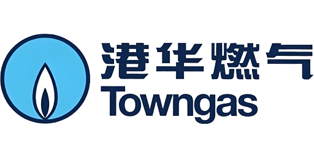

# 港华燃气（towngas）


#### 基于 [towngasShandong](https://github.com/mingyue5826/TongwangasShandong) 修改
## 安装集成

### 方式一：HACS

[](https://my.home-assistant.io/redirect/hacs_repository/?owner=caiwx86&repository/towngas_ha&category=integration)

点上面的按钮一键添加，或者手动操作：

1. 在 Home Assistant 中打开 **HACS**。
2. 进入 **集成** → 右上角菜单（⋮）→ **自定义仓库**。
3. 添加仓库 `https://github.com/caiwx86/towngas_ha`，类别选 **集成（Integration）**。
4. 在 **港华燃气** 卡片中点击 **下载**。
5. 按提示 **重启** Home Assistant。

### 方式二：手动安装

1. 将 Release 中的文件解压后复制到 Home Assistant 配置目录下：

   `config/custom_components/towngas_ha/`

2. **重启** Home Assistant。

## 添加设备

1. 打开 **设置** → **设备与服务** → **添加集成**。
2. 搜索 **港华燃气**（或 **towngas_ha**）并选择。
3. 选择所在区域的 **燃气公司**（下拉框从 orglist.json 读取）。
4. 选择 **认证方式**（两种任选）：

   | 方式 | 需要输入 | 说明 |
   | --- | --- | --- |
   | **用微信授权码自动登录**（推荐） | `authCode` | 只要一个值，集成自动换取 access_token + refresh_token |
   | 手动粘贴 token | `access_token` + `refresh_token` | 抓包拿到的那一对 |

5. 勾选要添加的一个或多个 **户号**，完成向导。

### 认证方式一：微信授权码（推荐）

只需要一个 `authCode`（微信 OAuth 授权码），集成调用
`POST /vcc-oauth/oauth/authorize2/accessToekn` 自动换取
**access_token + refresh_token**，省去在抓包工具里翻响应体。

`authCode` 的获取位置（二选一）：

- H5 登录后跳转页面的**地址栏** `?code=xxxx`（例如
  `.../h5-gas/pages/transitionPage/index?code=xxxx`）
- 抓包中 `accessToekn` 请求的 **`authCode` 参数**

> ⚠️ **微信授权码是一次性的，约 5 分钟失效。** 由于 H5 页面在跳转时会立即用它
> 换取 token，等你从地址栏复制时它**通常已经被消费掉了**。因此这种方式更适合
> 「拦截到请求、先复制 authCode、再放行」的抓包操作，或用于
> [重新认证](#重新认证)。
>
> **若失败会提示 `authCode 无效或已被使用`**，此时请改用方式二。

### 认证方式二：手动粘贴 token

- `access_token`（必填）
- `refresh_token`（**强烈建议填写**，与 access_token 来自同一个响应）
- `sign`（**可留空**，集成会自动计算）

> **关于 sign**：`sign` 与「本次请求的全部参数 + 时间戳」强绑定，**每次请求都不同**，
> 因此不存在一个可以反复使用的固定值。集成内置了与服务端一致的签名算法
> （见下方 [sign 算法](#sign-算法)），**留空即可自动计算，这是推荐做法**。
> 仅当自动计算在某个区域不适用时，才需要手动填入抓包得到的 sign 作为兜底。

> **关于 refresh_token**：它与 access_token 在**同一个响应**里下发（见
> [信息获取方式](#信息获取方式)）。若留空，集成仍可添加，但 access_token 约
> **2 小时**后过期即无法自动续期，所有实体会停止更新（HA 日志会明确告警），
> 届时需要重新抓包并在集成「配置」中更新。填写后集成会自动续期，无需人工干预。

### 重新认证

当 refresh_token 失效（接口返回 `resultCode=90143`）时，HA 会自动弹出重新认证流程，
同样提供上面两种方式。**推荐用授权码方式**：只需一个新的 `authCode`，
不用再去核对一长串 token。

### 实体说明

每个户号作为一个设备，包含以下实体：

**传感器**

| 实体 | 说明 | 单位 |
| --- | --- | --- |
| 应缴费用 | 当前应缴费用 | 元 |
| 可用余额 | 账户可用余额 | 元 |
| 上次抄表日期 | 上次抄表时间 | - |
| 本期费用 | 本期气费 | 元 |
| 阶梯气价 | 当前阶梯气价状态 | - |
| 用气趋势 | 月度用气趋势数据（attributes.graph） | - |
| 用气明细 | 月度用气明细数据（attributes.graph） | - |

**按钮**

| 实体 | 说明 |
| --- | --- |
| 刷新数据 | 立即调用接口刷新数据 |
| 刷新 Token | 立即刷新 token 并刷新数据 |

## 用气卡片（Lovelace）

集成附带一张零依赖的 Lovelace 卡片，展示可用余额 / 应缴费用 / 累计用气量、
用气卡片（本月用气 + 每日曲线）、用气阶梯、用气日历、年对比用气曲线、用气明细与日用气曲线。

**卡片随集成自动就绪：不需要手动复制文件，也不需要手动在仪表盘里添加 JS 资源。**

### 自动注册是怎么做的

集成加载时会做两件事：

1. 把集成自带的 `www/` 目录挂载为静态路径 `/towngas_ha/`；
2. 把 `/towngas_ha/towngas-ha-card.js?v=<集成版本>` 登记为 Lovelace 资源。

登记方式按你的仪表盘资源模式自动分流：

| 资源模式 | 集成行为 | 效果 |
| --- | --- | --- |
| **storage**（默认） | 写入仪表盘资源表 | 可在 **设置** → **仪表盘** → 右上角 **⋮** → **资源** 中看到，按需加载，Cast 设备（Chromecast / Nest Hub）也能显示卡片 |
| **yaml** | 退回全局注入 | 与 `frontend.extra_module_url` 同款机制；所有面板都会加载该 JS，Cast 设备不加载 |

> 资源 URL 上的 `?v=` 是缓存穿透参数，HACS 升级集成后版本号变化，浏览器会自动拉取新卡片。
> 该资源由集成自动维护，请在「资源」列表中**不要手动删除**。

### 添加卡片

仪表盘 → 右下角 **编辑** → **+ 添加卡片** → 搜索 **港华燃气用气卡片** 直接添加，
或在「手动」中填入：

```yaml
type: custom:towngas-ha-card
gs: "1111111111"    # 户号；留空则自动探测
title: 港华燃气
```

> 升级集成后若卡片外观没变化，强制刷新浏览器（Windows/Linux `Ctrl + Shift + R`，
> macOS `Cmd + Shift + R`）。

### 曾经手动添加过资源？

早期版本需要手动把 JS 复制到 `config/www/community/towngas-ha/` 并手动添加资源。
如果照做过一次，请到 **设置** → **仪表盘** → **⋮** → **资源** 里**删除**那条
`/local/community/towngas-ha/towngas-ha-card.js`。
不删也能用（卡片自身做了重复注册保护），但同一份 JS 会被加载两次。

### 卡片不显示？

1. 打开 **设置** → **仪表盘** → **⋮** → **资源**，确认存在
   `/towngas_ha/towngas-ha-card.js?v=...`；不存在则**重启 Home Assistant**。
2. 重启后仍不显示，开启 debug 日志查看注册失败原因：

   ```yaml
   logger:
     logs:
       custom_components.towngas_ha: debug
   ```

   日志中会输出 `已自动登记 Lovelace 卡片资源` 或具体的失败原因。
3. 确认浏览器已强制刷新（`Ctrl/Cmd + Shift + R`）。

功能明细、实体依赖与常见问题见
[卡片使用说明](towngas-ha-card.md)。


## 信息获取方式

配置信息需要小程序抓包，建议用电脑端微信小程序进行抓包，手机抓包需要 root 或其他复杂方式。

1. 选择适合自己设备的架构和版本下载并安装 [Reqable](https://reqable.com/zh-CN/download/)。
2. 启动抓包工具。
3. 打开你所在区域的微信小程序（或公众号 H5 页面），用微信账号登录。
4. 在抓包工具中搜索 `/nv1/vcc-cbs/usersubs/getLoginUserInfo`。

   > **不要搜完整域名。** 各区域网关域名不同（见 `orglist.json` 的 `host` 字段，
   > 例如 `weixin.hatowngas.com.cn`、`jngas.jinantowngas.com.cn`、
   > `weixin.towngasvcc.com`），按**接口路径**搜索才能抓到。

5. 双击抓包结果，在右侧找到 **请求头**。
6. 请求头中的 `Authorization: Bearer xxx` 的 `xxx` 即为 `access_token`。

#### 获取 refresh_token

`refresh_token` **和 access_token 在同一个响应里下发**，需要抓登录换 token 的那一步：

7. 在抓包工具中搜索 `/vcc-oauth/oauth/authorize2/accessToekn`。

   > 路径里的 `accessToekn` 是**服务端自己的拼写错误**（正确应为 `accessToken`），
   > 照原样搜索，不要"纠正"。

8. 该请求的**响应体**形如：

   ```json
   {
     "access_token": "ebd2237...",
     "refresh_token": "e6bb427...",
     "expires_in": 7200,
     "scope": "",
     "openId": ""
   }
   ```

   `refresh_token` 字段即为所需值，`expires_in` 为 7200 秒（2 小时）。

   > 若抓包里没有这条请求，说明 H5 复用了缓存的 token、没有走登录流程。
   > 此时**退出登录后重新登录**，或等 access_token 过期后再操作，即可触发。

9. `sign` **不需要抓**——留空即可，集成会自动计算（见 [sign 算法](#sign-算法)）。

> **更省事的做法**：如果嫌翻响应体麻烦，可以改用**认证方式一（微信授权码）**——
> 只复制一个 `authCode` 即可，集成会自己调上面这个接口换回这对 token。
> 详见 [认证方式一](#认证方式一微信授权码推荐)。

> `orgId` / `host` 由 `orglist.json` 提供，无需手动输入。
> 若你的区域不在下拉框中，请把该区域信息补进 `orglist.json` 的 `orgList` 数组
> （字段：`orgId`、`orgName`、`orgCode`、`host`，`host` 填抓包请求的 `Host` 头，
> 不带路径和协议前缀）。

## sign 算法

集成内置了与前端一致的签名算法（`custom_components/towngas_ha/sign.py`）：

```
sign = MD5( 按 key 排序拼接的 "key+value" 串 + "hbasesoft.com-prod" ).toUpperCase()
```

- 跳过 `sign` 自身，跳过值为 `null` / 空串的参数
- 参数需**包含 `timestamp`**
- 盐值 `hbasesoft.com-prod` 来自前端 `"hbasesoft.com-" + 环境名("prod")`

该算法反编译自 H5 前端构建产物，并用**真实抓包逐字节验证**：

| 请求 | 参数 | sign |
| --- | --- | --- |
| `getLoginUserInfo` | `timestamp=1791728307821` | `941CAF075D4A2E4332143D0DABEE4474` |
| `queryBindList` | `isPay=N`、`orgId=2c90d889…`、`timestamp=1791728804211` | `6B7ED3BABFDD5D010EAC221225CA7083` |

回归测试见 `tests/test_sign.py`：

```bash
python3 tests/test_sign.py
```

> **注意**：盐值中的 `hbasesoft.com` 与 `prod` 是否随区域/环境变化尚未穷尽验证。
> 已验证的是 `weixin.towngasvcc.com`。若某个区域自动计算后报签名错误，
> 请在集成配置里手动填入一个抓包得到的 `sign` 作为兜底。

## Token 刷新机制

- 集成初始化时保存 token 到 HA 缓存和本地文件（`.storage/towngas_ha/{mobile}.json`）。
- 每 30 分钟自动调用 refreshToken 接口刷新 token。
- 业务接口返回 `resultCode=20001`（access_token 过期）时自动刷新并重试。
- refreshToken 失效（`resultCode=90143`）时会提示重新认证，实体保持上次数据不变。
- 未配置 refresh_token 时，access_token 无法自动续期，日志会明确告警（不会静默失效）。

## 集成配置

添加集成后，可以在集成页面点击 **配置** 按钮重新配置：

- access_token
- refresh_token
- sign
- 数据刷新间隔（分钟）

## 问题反馈

如遇到问题，请提交 [Issue](https://github.com/caiwx86/towngas_ha/issues)。

开启 debug 日志排查问题：

```yaml
logger:
  default: warning
  logs:
    custom_components.towngas_ha: debug
```

## 仓库结构（开发参考）

```
custom_components/towngas_ha/   # 集成本体 —— HACS 只会安装这个目录
├── manifest.json
├── api.py                               # API 客户端（业务接口 + refreshToken + accessToekn）
├── sign.py                              # 请求签名算法（反编译自 H5 前端，含验证依据）
├── config_flow.py                       # 配置流（授权码 / 手动 token 两种认证方式）
├── frontend.py                          # 卡片自动注册（静态路径 + Lovelace 资源）
├── towngas-ha-card.md          # 卡片使用说明
└── www/                                 # 卡片 JS，挂载为 /towngas_ha/ 对外提供
    └── towngas-ha-card.js
preview/                                 # 开发用预览页与截图，仅存于仓库，不随集成安装
tests/test_sign.py                       # sign 算法回归测试（含真实抓包向量）
hacs.json                                # HACS 仓库元信息
```

运行 sign 算法回归测试：

```bash
python3 tests/test_sign.py
```

两条关键约定：

- **卡片 JS 必须放在 `custom_components/towngas_ha/www/`，不能放仓库根目录。**
  HACS 安装「集成」类仓库时只复制 `custom_components/<domain>/` 这棵子树
  （源码见 HACS `HacsIntegrationRepository.localpath` / `content.path.remote`），
  仓库根目录的文件不会进入用户的 HA 配置目录，静态路径自然取不到文件。
  （根目录放 `www/` 是「插件 / 仪表盘」类仓库的约定 —— 那类仓库才由 HACS 把文件复制到
  `config/www/community/<仓库名>/`。）
- **`www/` 是公开目录**：其中每个文件都能通过 `/towngas_ha/<文件名>` 直接访问，
  所以预览页、截图、开发脚本、说明文档一律放在集成外 —— 本仓库放根目录 `preview/`
  与集成根目录的 `towngas-ha-card.md`。
